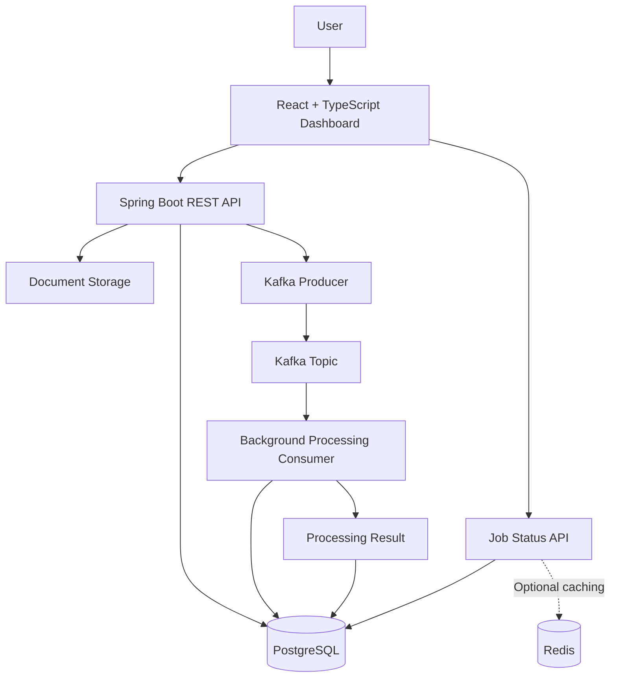

# Distributed Document Processing Platform

A full-stack document processing platform designed to demonstrate asynchronous job execution, REST API development, reliable messaging, and job lifecycle management using Java and modern web technologies.

The platform allows users to submit documents, track processing jobs, and inspect processing results through a React-based dashboard. Apache Kafka decouples document submission from processing, while PostgreSQL persists job metadata and processing states.

> **Project status:** In development. Features and setup instructions will be updated as implementation progresses.

## Overview

Document processing can involve time-consuming operations that should not block an API request. This project explores how to build a system that accepts document submissions, creates trackable jobs, processes them asynchronously, and exposes their status through a web interface.

The main engineering goals are to:

- Build RESTful APIs using Java and Spring Boot.
- Decouple document submission from background processing using Apache Kafka.
- Persist document metadata, job status, and processing results in PostgreSQL.
- Explore Redis caching for frequently accessed job information.
- Build a responsive frontend using React and TypeScript.
- Implement validation, exception handling, transaction management, and automated tests.
- Demonstrate reliability through duplicate-message handling, retries, and failure scenarios.

## Technology Stack

| Technology | Purpose |
|---|---|
| Java | Backend application development |
| Spring Boot | REST APIs and application services |
| Spring Data JPA | Database access and persistence |
| PostgreSQL | Document metadata, jobs, and results |
| Apache Kafka | Asynchronous processing and messaging |
| Redis | Caching frequently accessed data |
| React | Frontend user interface |
| TypeScript | Type-safe frontend development |
| Docker Compose | Local development infrastructure |
| JUnit 5 | Backend testing |
| GitHub Actions | Continuous integration |

## Architecture



### Component Responsibilities

**Frontend**
- Submit documents through an upload interface.
- Display recent processing jobs.
- Show processing statuses and job details.
- Present successful results and safe error messages.

**Spring Boot REST API**
- Validate incoming document submissions.
- Create document records and processing jobs.
- Publish processing requests to Kafka.
- Expose endpoints for job status and result retrieval.
- Handle exceptions and return consistent API responses.

**PostgreSQL**
- Persist document metadata and job lifecycle states.
- Store processing results and relevant timestamps.
- Enforce data integrity through database constraints and migrations.

**Apache Kafka**
- Decouple request handling from background processing.
- Deliver processing requests to consumers.
- Support retry and failure-handling strategies as the system evolves.

**Redis**
- Potentially cache frequently accessed job status information.
- Use explicit expiration and invalidation rules to limit stale reads.

**Background Processing Consumer**
- Consume processing requests.
- Validate and process submitted documents.
- Persist processing outcomes.
- Record failures and handle duplicate message delivery safely.

## Core Features

The following are the planned capabilities; completed functionality will be marked as implemented as development progresses.

- [ ] Document upload through a REST API
- [ ] Server-side document validation and metadata persistence
- [ ] Asynchronous processing using Kafka producer/consumer architecture
- [ ] Job lifecycle tracking: `RECEIVED`, `QUEUED`, `PROCESSING`, `COMPLETED`, `FAILED`
- [ ] Job status and result retrieval APIs
- [ ] Job listing with pagination and status filtering
- [ ] React + TypeScript document submission interface
- [ ] Processing dashboard and job detail view
- [ ] Consistent API errors and validation responses
- [ ] Automated unit and integration tests
- [ ] Bounded retries and dead-letter handling
- [ ] Redis caching with explicit invalidation
- [ ] Structured logging and correlation IDs
- [ ] Docker-based local development
- [ ] Continuous integration and project documentation

## Project Structure

The following is the proposed repository structure and can be adjusted to match the implementation.

```text
distributed-document-processing-platform/
├── backend/
│   ├── src/
│   │   ├── main/
│   │   │   ├── java/
│   │   │   │   └── ...
│   │   │   └── resources/
│   │   └── test/
│   └── pom.xml
├── frontend/
│   ├── src/
│   │   ├── components/
│   │   ├── pages/
│   │   ├── services/
│   │   ├── hooks/
│   │   └── types/
│   └── package.json
├── docs/
│   └── architecture/
├── docker-compose.yml
├── .env.example
├── .gitignore
└── README.md
```

## Getting Started

### Prerequisites

Install the following before running the complete application:

- JDK version compatible with the configured Spring Boot project
- Maven
- Node.js and npm
- Docker and Docker Compose
- Git

PostgreSQL, Kafka, and Redis can be run locally through Docker Compose if included in the project configuration.

### 1. Clone the repository

```bash
git clone https://github.com/YOUR_USERNAME/distributed-document-processing-platform.git
cd distributed-document-processing-platform
```

Replace `YOUR_USERNAME` with your GitHub username.

### 2. Configure environment variables

Create your local environment configuration using `.env.example` as a reference.

Typical configuration values include:

```dotenv
SPRING_PROFILES_ACTIVE=local
DB_HOST=localhost
DB_PORT=5432
DB_NAME=document_processing
DB_USERNAME=app
DB_PASSWORD=change_me
KAFKA_BOOTSTRAP_SERVERS=localhost:9092
REDIS_HOST=localhost
REDIS_PORT=6379
```

These are illustrative values. Map them to the actual configuration properties used by your application.

Never commit real credentials, tokens, or production secrets.

### 3. Start the infrastructure

If Docker Compose has been configured:

```bash
docker compose up -d
```

Verify that the configured services are healthy before starting the backend.

### 4. Start the backend

From the `backend/` directory:

```bash
./mvnw spring-boot:run
```

On Windows, use:

```powershell
.\mvnw.cmd spring-boot:run
```

If the Maven wrapper has not been added, use the installed Maven executable instead.

### 5. Start the frontend

From the `frontend/` directory:

```bash
npm install
npm run dev
```

Use the development URL printed by the frontend tooling to open the application.

> These instructions assume the proposed directory layout and scripts. Update them to reflect the actual repository configuration.

## API Design

The following endpoint structure is proposed for the application.

| Method | Endpoint | Purpose |
|---|---|---|
| `POST` | `/api/documents` | Upload a document and create a processing job |
| `GET` | `/api/jobs` | List jobs with pagination and filters |
| `GET` | `/api/jobs/{jobId}` | Retrieve job status and metadata |
| `GET` | `/api/jobs/{jobId}/result` | Retrieve the processing result |
| `GET` | `/api/jobs/{jobId}/history` | Retrieve job lifecycle history |

### Example: Submit a Document

```bash
curl -X POST http://localhost:8080/api/documents \
  -F "file=@sample.pdf"
```

An illustrative successful response:

```json
{
  "documentId": "doc-123",
  "jobId": "job-456",
  "status": "QUEUED"
}
```

The actual response fields and status values will depend on the implemented API contract.

### Example: Retrieve Job Status

```bash
curl http://localhost:8080/api/jobs/job-456
```

An illustrative response:

```json
{
  "jobId": "job-456",
  "status": "COMPLETED",
  "submittedAt": "2026-10-10T08:30:00Z",
  "completedAt": "2026-10-10T08:30:04Z",
  "result": {
    "filename": "sample.pdf",
    "processingOutcome": "SUCCESS"
  }
}
```

These examples describe the intended API behavior; use real response payloads once the endpoints are implemented.

## Processing Lifecycle

A typical job moves through the following states:

1. **RECEIVED** — The document submission has been accepted.
2. **QUEUED** — A processing request has been published for asynchronous execution.
3. **PROCESSING** — A consumer has started working on the job.
4. **COMPLETED** — Processing finished successfully.
5. **FAILED** — Processing failed and the job records a safe error summary.

State transitions should be validated so that duplicate messages or concurrent updates do not incorrectly overwrite a terminal state.

## Reliability and Error Handling

The project will explore production-minded backend practices, including:

- Server-side validation of file type and size.
- Generated storage identifiers rather than trusting uploaded filenames.
- Consistent HTTP status codes and structured API errors.
- Transaction boundaries around database updates.
- Idempotent consumer behavior for duplicate Kafka deliveries.
- Bounded retries and dead-letter handling for failed messages.
- Explicit cache invalidation and database fallback when Redis is unavailable.
- Correlation IDs for tracing a job across API and consumer logs.
- Tests for both successful processing and failure scenarios.

A transactional outbox may be introduced to address consistency between database writes and Kafka event publication.

## Testing Strategy

Testing will be organized by responsibility.

**Unit tests**
- Job state transitions.
- Validation and processing logic.
- Error mapping and business rules.

**Integration tests**
- REST API request and response behavior.
- PostgreSQL persistence and schema migrations.
- Kafka producer/consumer workflows.
- Duplicate message handling and retry behavior.
- Redis cache invalidation and fallback behavior.

**Frontend tests**
- File validation and upload submission.
- Loading, empty, and error states.
- Job status and result rendering.

Tests should verify observable behavior and important failure cases, not merely execute code.

## AI-Assisted Development

AI tools are used as development partners for implementation planning, code generation, debugging, test design, and code review.

The development workflow is:

1. Break requirements into small user stories with explicit acceptance criteria.
2. Ask AI to explain the design and identify risks before implementation.
3. Generate focused changes rather than entire application modules at once.
4. Run tests and verify framework behavior.
5. Review AI-generated code and understand the final implementation.
6. Record design decisions, limitations, and test evidence.

AI-generated code is reviewed and validated before being accepted. No secrets, proprietary source code, or sensitive documents should be shared with AI tools.

## Roadmap

- [ ] Establish the backend, frontend, and local infrastructure
- [ ] Implement document submission and metadata persistence
- [ ] Add job status APIs and lifecycle validation
- [ ] Integrate Kafka-based asynchronous processing
- [ ] Build the job dashboard and detail page
- [ ] Add reliability tests, retries, and failure handling
- [ ] Introduce caching where justified
- [ ] Add CI, observability, and documentation
- [ ] Prepare a reproducible end-to-end demo

## Learning Objectives

This project is intended to provide hands-on experience with:

- Java and Spring Boot application design
- REST API contracts and backend validation
- Relational data modeling and transaction management
- Kafka messaging and asynchronous workflows
- Distributed processing failure modes
- Cache consistency and invalidation
- React and TypeScript integration with backend services
- Automated testing, CI, and maintainable documentation

## Future Enhancements

Potential future improvements include:

- Authentication and role-based access control
- Cloud-based document storage
- Additional document formats and extraction strategies
- Server-Sent Events for live status updates
- A transactional outbox for reliable event publication
- Metrics dashboards and operational alerts
- Containerized deployment to a cloud environment

These are potential extensions, not claims about current functionality.

---

**Built as a hands-on exploration of Java backend engineering, asynchronous document processing, and AI-assisted software development.**
